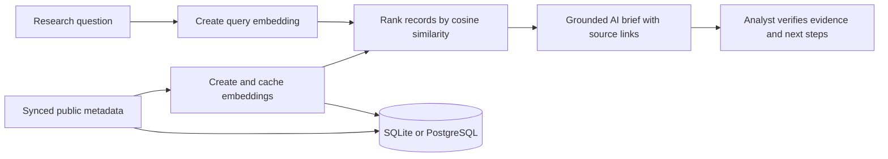

# Opportunity Radar

### Investigate the world. Find the signal. Show the evidence.

Opportunity Radar is an early-stage investigation platform for turning public information into better business questions. It starts with Poland’s open-data catalogue: collect dataset metadata, search across it, retrieve relevant records for a research question, and produce an AI brief that points back to its sources.

The long-term ambition is a strategic intelligence workspace for companies: a place to investigate markets, sectors, competitors, regulation, public investment, and emerging risks—with evidence and uncertainty visible at every step.

> **Project status:** working MVP. Catalogue sync, local persistence, search, saved records, semantic retrieval, source-linked AI briefs, and a REST API are implemented. The broader company-intelligence vision is the roadmap, not a claim about current capabilities.

## Why I’m building it

I’m interested in the gap between *having information* and *knowing what to investigate next*. Public data is abundant, fragmented, and often difficult to connect to a real commercial question. I want to build tools that help an analyst move from a question to relevant evidence, identify what is still unknown, and decide what to validate next.

That means treating AI as an assistant to an investigation—not as an authority. Opportunity Radar is designed to make sources inspectable, separate evidence from hypotheses, and make uncertainty part of the output. The first version is deliberately narrow so the ingestion, retrieval, persistence, and API foundations can be tested before adding more sources and more ambitious analysis.

## What works today

- **Catalogue ingestion:** fetches up to 400 recently modified dataset records from Poland’s open-data API, validates required fields, and updates existing records.
- **Research dashboard:** search locally stored records, browse metadata, save signals, and open the original catalogue page.
- **Semantic investigation:** embed stored metadata, rank records by cosine similarity to a question, and generate a brief with numbered source links.
- **Focused analysis:** request and persist an AI review of an individual dataset.
- **REST API:** validated FastAPI endpoints with a generated OpenAPI schema and interactive docs at `/docs`.
- **Persistence:** SQLAlchemy models support SQLite for local development and PostgreSQL through Docker Compose.
- **Quality checks:** automated tests and Ruff run in GitHub Actions.

## How an investigation works



1. Sync catalogue records into the local database.
2. Ask a research question in the dashboard or through the API.
3. Retrieve the most semantically similar stored records.
4. Generate a cautious brief using those records as context.
5. Follow the citations, check the original source, and investigate the gaps.

The current retriever works over **dataset metadata**, not the underlying files. Similarity is a relevance signal for retrieval; it is not a probability that an opportunity is real.

## Technology

| Area | Implementation |
| --- | --- |
| API and validation | Python 3.12+, FastAPI, Pydantic, OpenAPI |
| Persistence | SQLAlchemy 2, SQLite locally, PostgreSQL in Compose |
| Public source | Poland’s `api.dane.gov.pl` catalogue |
| Retrieval and analysis | OpenAI embeddings, cosine-similarity retrieval, source-grounded Responses API briefs |
| Interface | HTML, CSS, and JavaScript |
| Runtime and delivery | Uvicorn, Docker, Docker Compose, GitHub Actions |
| Testing and style | pytest, Ruff |

FastAPI already provides the API server and OpenAPI documentation, so Flask would duplicate the same role. TensorFlow is not part of scoring yet: there is no labeled set of investigation outcomes to train or evaluate a useful model. The current retrieval baseline stays simple and explainable until real feedback can support a measured model.

## Run locally

Requires Python 3.12+ and [`uv`](https://docs.astral.sh/uv/).

```bash
uv sync --all-groups
uv run python main.py
```

Open [http://127.0.0.1:8765](http://127.0.0.1:8765). API docs are at `/docs`; the machine-readable schema is at `/openapi.json`. Data is stored in `data/opportunity-radar.sqlite3` by default.

### Enable AI features

Copy `.env.example` to `.env` and set `OPENAI_API_KEY`. The default models are `gpt-4.1-mini` and `text-embedding-3-small`; configure alternatives with `OPENAI_MODEL` and `OPENAI_EMBEDDING_MODEL`.

Semantic investigation sends the question and relevant public dataset metadata to the configured model provider. Embedding and generation calls may incur provider charges. No API key is needed to browse, search, sync, or save catalogue records.

### Run with PostgreSQL

With Docker and Docker Compose installed:

```bash
docker compose up --build
```

Compose starts the application with PostgreSQL 16 and a persistent database volume. Set `POSTGRES_PASSWORD` through the environment before using this configuration outside a local development environment.

## API examples

```http
GET /api/datasets?q=energy&saved=false
GET /api/stats
POST /api/sync
Content-Type: application/json

{"query":"energy"}
```

```http
POST /api/investigate
Content-Type: application/json

{"query":"What public-data signals could help investigate energy efficiency?","top_k":5}
```

Other endpoints: `POST /api/analyze` and `POST /api/save`. Explore request schemas and try calls interactively at `/docs`.

## Design choices and current limits

- **Evidence before confidence:** briefs are instructed to cite retrieved records, distinguish hypotheses, and describe evidence gaps. Citation formatting is not a guarantee that every generated claim is correct; check the linked sources.
- **Narrow source coverage:** only Poland’s open-data catalogue is currently integrated. The app does not yet ingest full files, company records, news, tenders, or regulatory documents.
- **Metadata-only retrieval:** sparse or vague descriptions can lead to weak retrieval. Underlying tables and documents are not parsed or indexed yet.
- **No validated opportunity score:** there is no labeled benchmark, precision/recall study, or measured prediction accuracy. Similarity scores only order retrieved records.
- **Single-user MVP:** saved signals and analyses are local records. Accounts, team workspaces, access controls, audit history, and production operations are not implemented.
- **AI cost and data flow:** AI features require external provider calls. Review provider terms and organizational data policies before using the platform with sensitive research.

## Roadmap

### 1. Make investigations deeper

- Download and parse supported source files, retaining dataset and resource provenance.
- Add robust text/table extraction, chunking, and retrieval across the source material itself.
- Improve citation precision so claims link to the exact dataset resource or passage.
- Track changes over time and surface newly published or materially updated information.

### 2. Build a company strategy workspace

- Let a company define its sectors, markets, strategic priorities, and watchlists.
- Combine open datasets with carefully selected sources such as public tenders, legislation, company registers, and economic statistics.
- Connect entities, places, sectors, policy changes, and events into an explorable evidence graph.
- Generate investigation plans: what is known, what is uncertain, which sources could resolve it, and what to validate with customers or domain experts.
- Support shared case files, notes, source review, and exportable evidence-backed reports.

### 3. Evaluate before adding predictive ML

- Capture analyst feedback on relevance, evidence quality, and whether a lead was useful.
- Create a reviewed, versioned evaluation set and measure retrieval quality before tuning ranking.
- Test ranking approaches—including a TensorFlow model—against a transparent baseline and report results with confidence limits.
- Monitor stale sources, citation coverage, and unsupported claims as product-quality metrics.

### 4. Prepare for organizational use

- Add authentication, role-based access, audit logs, and per-workspace data boundaries.
- Establish retention, encryption, backup, and deployment policies suitable for company research.
- Add observability, background ingestion jobs, rate limits, and operational health checks.

## Development

```bash
uv run python -m pytest -q
uv run python -m ruff check src tests main.py
```

The test suite uses isolated SQLite databases and mocked providers; it does not require API credentials or make external API calls.

## Current snapshot

- Up to **400 records** per catalogue refresh.
- **11 automated tests** passing in the current MVP.
- **One integrated public-data source**; AI investigation is optional.

These are implementation and test counts—not a claim about commercial impact or opportunity-prediction accuracy.
